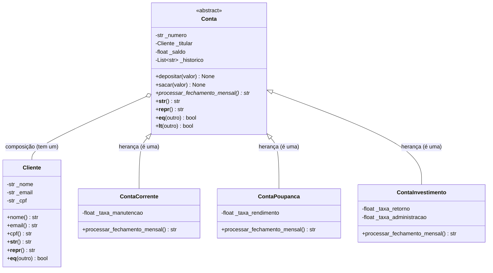

# Sistema Bancário Orientado a Objetos em Python 

Projeto desenvolvido para o entregável de **Desenvolvimento em Python (Semanas 06, 07 e 08)** aplicando Programação Orientada a Objetos (POO) com Python, seguindo a PEP 8, docstrings, encapsulamento com `@property`, classe abstrata (`ABC`), herança com `super()`, polimorfismo, métodos especiais (*dunder methods*) e tratamento de exceções.

## Diagrama de Classes (Mermaid)



## Decisões de Modelagem (Herança vs. Composição)

- **Herança (`ContaCorrente`, `ContaPoupanca` e `ContaInvestimento` herdam de `Conta`):** Aplicada porque a relação é claramente **"é um"** — toda conta corrente, poupança ou de investimento *é uma* `Conta`. A classe abstrata `Conta` define o contrato obrigatório (`@abstractmethod def processar_fechamento_mensal`) e reaproveita código comum via `super().__init__(...)`.
- **Composição (`Conta` possui um `Cliente`):** Aplicada porque uma conta **"tem um"** titular (`Cliente`), e não *"é um"* cliente. Separar `Cliente` em uma classe independente permite que um mesmo cliente tenha várias contas sem duplicar seus dados cadastrais.

## Validações com `@property`

O encapsulamento garante que nenhum objeto seja criado ou modificado em estado inválido (tanto no `__init__` quanto em atribuições posteriores):

- **`Cliente.nome`:** Exige texto com no mínimo 3 caracteres.
- **`Cliente.email`:** Verifica a presença de `@` e de um domínio com `.`.
- **`Cliente.cpf`:** Exige exatamente 11 dígitos numéricos.
- **`Conta.saldo`:** Impede atribuição de valores negativos ou não numéricos.
- **`Conta.titular`:** Garante que o atributo receba apenas instâncias válidas de `Cliente`.
- **Taxas (`taxa_manutencao`, `taxa_rendimento`, `taxa_retorno`, `taxa_administracao`):** Impedem percentuais ou tarifas negativas.

## Exemplos de Uso e Execução

Para executar a demonstração com as **10 instâncias**, polimorfismo e tratamento de exceções (`try/except`):

```bash
python main.py
```

Exemplo resumido em código:

```python
from models import Cliente, ContaCorrente, ContaPoupanca

cliente = Cliente("Mickael Fiquene", "MF@email.com", "11122233344")
cc = ContaCorrente("CC-001", cliente, saldo_inicial=1500.0)
cp = ContaPoupanca("CP-001", cliente, saldo_inicial=3000.0)

for conta in [cc, cp]:
    print(conta.processar_fechamento_mensal())
```
