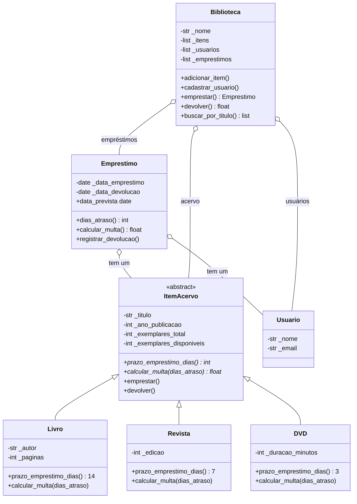

# 📚 Sistema de Biblioteca (POO em Python)

Sistema orientado a objetos que gerencia acervo, usuários e empréstimos de uma biblioteca.
Aplica **classes, encapsulamento (`@property`), herança, `super()`, polimorfismo, classes abstratas (`ABC`) e métodos especiais (dunder)**.

## Como executar

```bash
python main.py    # Python 3.10+, sem dependências externas
```

## Estrutura

```
sistema-biblioteca/
├── main.py                    # demonstração completa
└── biblioteca/
    ├── __init__.py
    ├── excecoes.py            # exceções do domínio
    ├── item_acervo.py         # ItemAcervo (abstrata), Livro, Revista, DVD
    ├── usuario.py             # Usuario
    ├── emprestimo.py          # Emprestimo
    └── biblioteca.py          # Biblioteca
```

## Diagrama de classes



## Decisões de modelagem

**Herança (relação "é um")**: `Livro`, `Revista` e `DVD` *são* itens do acervo. Compartilham título, ano, controle de exemplares e as operações `emprestar()`/`devolver()`, que ficam na classe mãe `ItemAcervo` (reuso de código). O que muda entre eles (prazo e multa) é declarado como **método abstrato**, o que obriga cada subclasse a definir sua regra e impede instanciar um "item genérico".

**Composição (relação "tem um")**: `Emprestimo` *tem um* `Usuario` e *tem um* `ItemAcervo`; `Biblioteca` *tem* itens, usuários e empréstimos. Um empréstimo não "é um" usuário nem "é um" item, então herança seria errada aqui.

**Por que não herdar `Usuario` de algo?** Não há hierarquia real de usuários neste domínio; criar uma seria herança artificial (princípio "prefira composição a herança").

**Polimorfismo**: `Emprestimo` e `Biblioteca` só conhecem a interface de `ItemAcervo`. Chamar `item.calcular_multa(5)` ou `item.prazo_emprestimo_dias` devolve valores diferentes conforme o tipo, sem nenhum `if tipo == ...`. Adicionar um novo tipo (ex.: `Audiobook`) não exige alterar as classes existentes.

| Tipo | Prazo | Multa |
|---|---|---|
| Livro | 14 dias | R$ 1,00/dia |
| Revista | 7 dias | R$ 0,50/dia |
| DVD | 3 dias | R$ 3,00/dia (máx. R$ 30,00) |

## Validações com `@property`

Todas rodam no `__init__` **e** nos setters, então nenhum objeto inválido chega a existir.

| Classe | Atributo | Regra |
|---|---|---|
| `ItemAcervo` | `titulo` | texto não vazio (espaços são removidos) |
| `ItemAcervo` | `ano_publicacao` | inteiro entre 1450 e o ano atual |
| `ItemAcervo` | `exemplares_total` | inteiro > 0; **somente leitura** |
| `ItemAcervo` | `exemplares_disponiveis` | inteiro entre 0 e `exemplares_total` |
| `Livro` | `autor` / `paginas` | texto não vazio / inteiro > 0 |
| `Revista` | `edicao` | inteiro > 0 |
| `DVD` | `duracao_minutos` | inteiro > 0 |
| `Usuario` | `nome` | mínimo de 2 caracteres |
| `Usuario` | `email` | formato válido (regex), normalizado para minúsculas |
| `Emprestimo` | construtor | tipos corretos; devolução não pode ser anterior à retirada nem repetida |

Erros de tipo levantam `TypeError`; valores fora da regra levantam `ValueError`; regras de negócio levantam `ItemIndisponivelError` e `UsuarioNaoCadastradoError` (herdam de `BibliotecaError`).

## Métodos especiais implementados

- `__init__` e `__str__` em **todas** as classes; `__repr__` em todas.
- `__eq__` / `__hash__`: itens são iguais se tiverem mesmo tipo, título e ano; usuários, se tiverem o mesmo e-mail.
- `__lt__`: itens e usuários são ordenáveis por título/nome (`sorted(biblioteca)`).
- `__len__` e `__iter__` em `Biblioteca`.

## Exemplos de uso

```python
from datetime import date
from biblioteca import Biblioteca, Livro, DVD, Usuario

ana = Usuario("Ana Souza", "ana@email.com")
livro = Livro("Dom Casmurro", 1899, "Machado de Assis", 256)
dvd = DVD("Cidade de Deus", 2002, 130)

bib = Biblioteca("Central", itens=[livro, dvd])
bib.cadastrar_usuario(ana)

emp = bib.emprestar(ana, livro, date(2026, 9, 1))
multa = bib.devolver(emp, date(2026, 9, 25))   # 10 dias de atraso
print(multa)                                   # 10.0

# Polimorfismo
for item in (livro, dvd):
    print(item.tipo, item.calcular_multa(5))   # Livro 5.0 / DVD 15.0

# Validação
try:
    Usuario("Carlos", "email-invalido")
except ValueError as erro:
    print(erro)                                # E-mail inválido: 'email-invalido'
```

A saída completa da demonstração (10+ objetos, polimorfismo e 10 casos de exceção) está em `main.py`.

## Equipe

_Preencham aqui os nomes dos integrantes._
